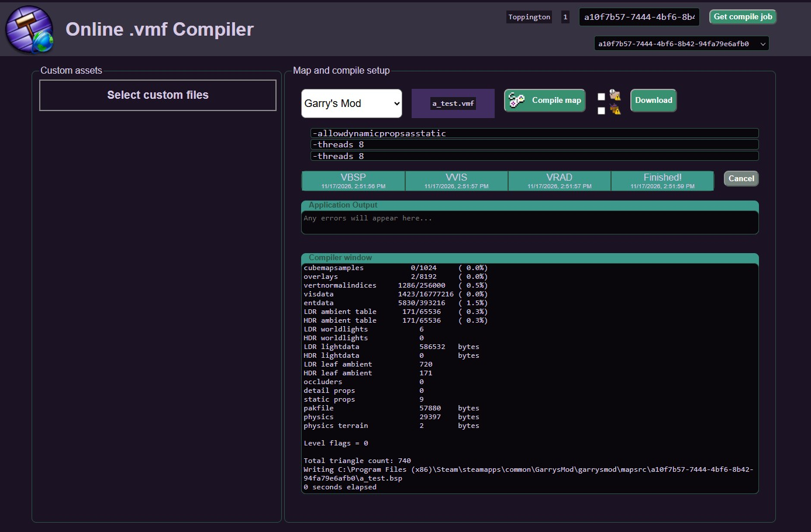
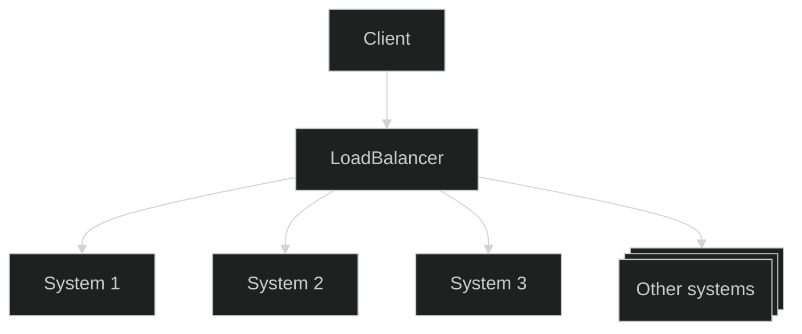

  


## Installation setup and start

### 1) Setup game files
> If you have your games installed in Steams default directory, can skip this step

in `config.json`, define the absolute path to the game directories of the games you want to compile maps for, aswell as the name of the vbsp, vvis and vrad-files to be used.
`sourceVmfs` is the directory where the compiled maps will be stored.  
It can also be an absolute path, if you want to store it somewhere else
```json
[
    {
        "name": "Garry's Mod",
        "path": "C:\\Program Files (x86)\\Steam\\steamapps\\common\\GarrysMod",
        "compilerPath": "bin",
        "vbsp": "vbsp.exe",
        "vvis": "vvis.exe",
        "vrad": "vrad.exe",
        "assetDir": "garrysmod",
        "sourceVmfs": "mapsrc"
    },
    {
        "name": "Team Fortress 2",
        "path": "C:\\Program Files (x86)\\Steam\\steamapps\\common\\Team Fortress 2",
        "compilerPath": "bin",
        "vbsp": "vbsp.exe",
        "vvis": "vvis.exe",
        "vrad": "vrad.exe",
        "assetDir": "tf2",
        "sourceVmfs": "mapsrc"
    }
]
```

### 2) Application startup
In the project root, install dependencies with `python -m pip install -r requirements.txt`, then run any of the .bat files fitting your use case (`run_frontend_backend.bat` is the most relevant one for standalone non-clustered setup)
```
cd online-vmf-compiler
.\run_frontend_backend.bat
```

## About
Gimmicky application for offloading Source engine map compiling tasks to a remote server.  
* Parses the .vmf file
* Resolves user-submitted custom assets using **webkitdirectory**.  
  * **The directory selected in "Select custom files"-section" will be available to the server. Files used in the .vmf are uploaded and persisted to the server.**
  * Referenced models include all provided related files (`.vmf`-file referencing `model001.mdl` will also fetch related models such as `model001.phy`, `model001.vvd`, `model001.dx80.vtx`, `model001.dx90.vtx`, `model001.sw.vtx`, and `model001.ani` if they are also found).  
    Each file is checked independently, so missing related files are uploaded even when the model itself already exists on the backend.
* No login
* Compile multiple files at the same time
* **Job-management**: see compile job's status (status and compile logs in real-time)
  * The progress bar shows each compiler step's status-file timestamp in local time.
  * Download compiled .BSP (permalink)
  * Submitted jobs and successfully retrieved jobs are saved in this browser's
    local storage. Select an entry under **Previous jobs** to load its status
    and download link again after refreshing or reopening the page. Entries store
    the job ID and ISO start date from the backend status, displayed as smaller
    local-time text to the right of the ID in the open dropdown list. The closed
    dropdown shows only the selected job ID.
    Existing ID-only entries are preserved; unknown start dates are filled in
    from job status when available rather than guessed.

## Cluster setup (Loadbalancer)
The Loadbalancer webservice (`/src/loadbalancer`) can be configured to point towards several systems (**Nodes**) running the Backend webservice (`/src/backend`). The loadbalancer will query each node and send the compile request to whatever node has the lowest current load.



The frontend proxy preserves `X-Served-By` responses and `X-Preferred-Node`
requests so asset uploads and compilation stay on the selected backend.
Job-status, cancellation, and BSP requests locate the backend that owns the job.
A missing job returns HTTP 404; requests requiring node selection return HTTP 503
when no backend is available.

### Shared storage between nodes

Nodes may use the same network share for job storage; no shared-storage switch
is needed in `nodes.json`. Multiple nodes finding a job is normal. Status and BSP
requests prefer its owner when reachable, otherwise they use another node that
can read the files.

New jobs have an `owner` file containing the creating backend's identity. This
defaults to the machine hostname. If multiple backends run on the same machine,
or machines have identical hostnames, set a distinct `OVMFC_NODE_ID` environment
variable for each backend before starting it. Keep that identity stable across
restarts; it is separate from the display names in `nodes.json`.

Only the owner includes a job in its running-job lists and counts, preventing
shared run files from being counted once per node. Cancellation requires a
reachable, verified owner, because status-file process IDs are local to that
machine. Both the load balancer and backend reject unsafe cancellation with
HTTP 409. Conflicting ownership claims also return HTTP 409 instead of an
unhandled exception.

Restart/upgrade **all backends and the load balancer** for this behavior.
Existing jobs without an `owner` file remain readable and downloadable, but
cannot be attributed to a node or safely cancelled through the API. They are
excluded from per-node running counts; new jobs are tracked automatically.

### Configurating multiple Nodes
Edit `nodes.json` in the repository root to set up the Nodes that should be used. A `weight`-parameter can be used to give certain Nodes higher or lower priority, if they have different specifications.
#### Example Node
```json
{
    "name": "Middleton",
    "address": "http://192.168.0.74",
    "weight": 5
}
```

### Cluster statistics

Open `/stats.html` on the frontend (or use **Statistics** in the header) to see
each node's address, weight, availability, and running jobs with job ID, game,
and map filename. The page refreshes every five seconds and supports manual
refresh. It requires the frontend to point at the load balancer.

The load balancer's `GET /api/stats` queries each backend's
`GET /api/running-jobs` concurrently. It returns `nodes` and `totalRunningJobs`
(the total on reachable nodes). Each node includes `online`, `jobCount`,
`runningJobs`, and `error`; unavailable nodes have null job counts/lists rather
than being reported as idle. Running jobs are identified by their run files and
reported only by the backend identified in their `owner` files.

### Live configuration updates

The load balancer watches its active `nodes.json`, and the backend watches its
active `config.json`. Changes, including replacing the file when saving, are
checked every second and applied without restarting either service. Backend
updates also rebuild the VPK asset index before publishing the new configuration.

The active file is selected at startup: an override in `%SystemDrive%\OVMFC`
(for example, `C:\OVMFC\config.json`) takes precedence over the working-directory
file. If neither exists, the service checks its `backend` or `loadbalancer`
subdirectory. The listener watches that selected path for the service's lifetime.
Malformed or unreadable updates are logged, and the last valid configuration
remains active until a subsequent valid edit. Listeners stop on service shutdown.

## Future features
* [x] Load-balancer middleware to spread compiler tasks across multiple computers (cluster setup)?
* [ ] Packing custom assets automatically?
